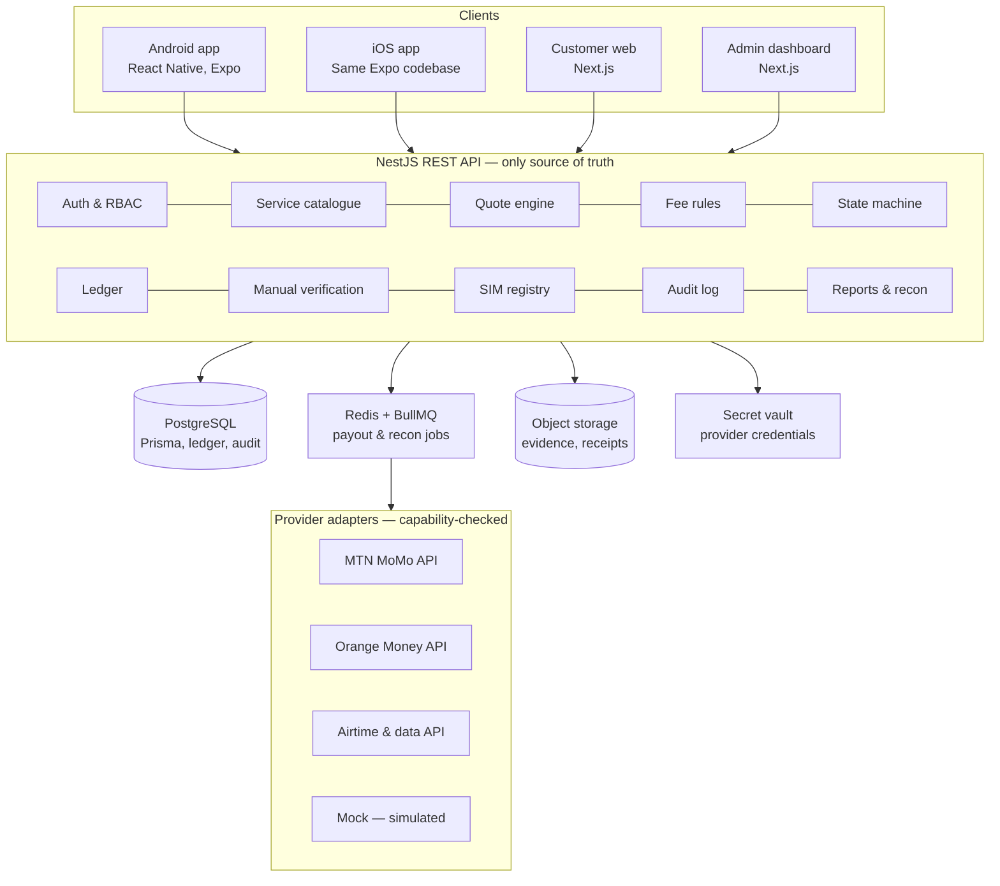
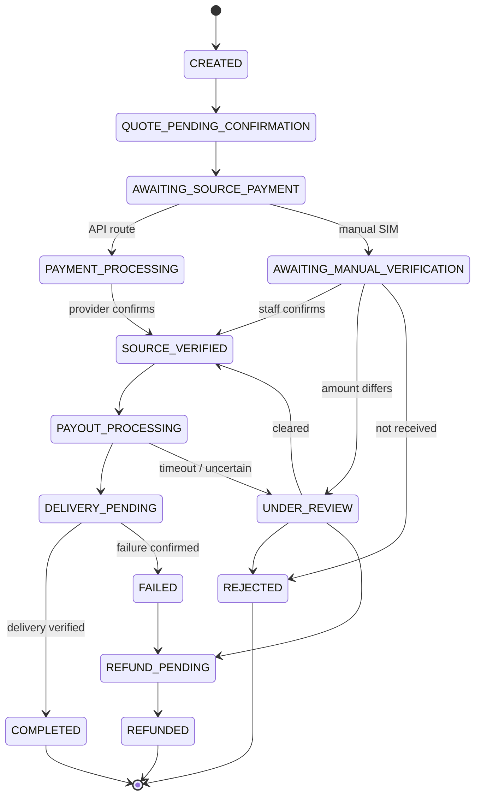

# Dev Plan — Cameroon Mobile Money & Airtime Exchange Platform

_As of 2026-10-10_

## 1. Scope and principles

We build one authoritative NestJS backend serving four clients (Android, iOS, customer web, admin web), deliver everything on mock providers first, and enable real money only after legal, provider and settlement gates are passed. The plan runs in seven phases over roughly 22 weeks to a controlled pilot.

**In scope**

- Four-SIM operating model: MTN and Orange business SIMs (API-driven), MTN and Orange normal SIMs (manual airtime receipt).
- Service catalogue of 12 exchange routes plus airtime and data bundle purchases, each independently activated, priced and capability-gated.
- Server-side quote engine, configurable platform fees, separate provider fees, versioned pricing rules.
- Manual airtime verification with dual approval for higher-risk transactions.
- Transaction state machine, double-entry ledger, idempotency, reconciliation and reporting.
- Expo mobile app, Next.js customer web app, Next.js admin dashboard, all on the same REST API.

**Guiding principles**

1. The backend is the only place money is calculated or moved. Clients display quotes; they never compute them.
2. Amounts are integer FCFA, stored as integers, never floats.
3. A service is visible only when its capability is configured, tested and authorised.
4. Nothing is `COMPLETED` until the destination operation is verified by the provider or a reconciliation.
5. Posted financial records are immutable; corrections are reversal or adjustment entries.
6. No PINs or operator secrets in the database; provider credentials live in a secret store.
7. Mock transactions are flagged end to end and can never settle against real balances.

## 2. Assumptions and routes to verify

Only the two mobile-money routes look technically straightforward; every route that takes airtime as the source depends on operator terms and regulation not yet confirmed. All routes start disabled; Phase 0 produces a signed feasibility matrix. Nothing below has been checked against live operator documentation or counsel — treat each item as open.

**Working assumptions**

- Business SIMs will be reached through either direct operator APIs (MTN MoMo Open API, Orange Money merchant/web-payment APIs) or a licensed aggregator; the adapter layer supports both.
- Collections (customer pays in) and disbursements (we pay out) are separate capabilities and may be granted separately.
- Airtime receipt on normal SIMs uses only the operator's own subscriber-to-subscriber transfer service, verified by staff from the SIM's own balance or SMS history — never by automated USSD or SIM toolkit.
- Airtime is not cash: each airtime-source route needs a configured conversion rate (e.g. 1,000 FCFA airtime may yield less than 1,000 FCFA payout).
- Operating a cross-network money service in Cameroon likely falls under CEMAC payment-services rules; a licence or partnership with a licensed institution may be required. To confirm with counsel.
- Production hosting, data residency and personal-data obligations are to be confirmed before pilot.

**Route feasibility matrix** (initial status = disabled for all)

| Route | Source receipt | Destination delivery | Main dependency | Risk |
| --- | --- | --- | --- | --- |
| MTN MoMo → Orange Money | MTN collection API | Orange disbursement API | Both APIs + settlement float | Medium |
| Orange Money → MTN MoMo | Orange collection API | MTN disbursement API | Both APIs + settlement float | Medium |
| MTN MoMo → MTN airtime | MTN collection API | Airtime top-up API | Airtime vending access | Low–medium |
| MTN MoMo → Orange airtime | MTN collection API | Airtime top-up API | Orange airtime vending access | Medium |
| Orange Money → Orange airtime | Orange collection API | Airtime top-up API | Airtime vending access | Low–medium |
| Orange Money → MTN airtime | Orange collection API | Airtime top-up API | MTN airtime vending access | Medium |
| Airtime and data bundle purchase | Mobile money collection | Top-up / bundle API | Bundle catalogue API | Low–medium |
| MTN airtime → MTN MoMo | Manual, normal MTN SIM | MTN disbursement API | Operator terms on reselling transferred credit; conversion rate | High |
| MTN airtime → Orange Money | Manual, normal MTN SIM | Orange disbursement API | Same as above + cross-network float | High |
| Orange airtime → Orange Money | Manual, normal Orange SIM | Orange disbursement API | Operator terms; conversion rate | High |
| Orange airtime → MTN MoMo | Manual, normal Orange SIM | MTN disbursement API | Same as above + cross-network float | High |
| MTN airtime → Orange airtime | Manual, normal MTN SIM | Orange airtime top-up | Commercial use of received credit; daily transfer caps | High |
| Orange airtime → MTN airtime | Manual, normal Orange SIM | MTN airtime top-up | Same as above | High |

**Questions Phase 0 must answer**

- [ ] Which provider (operator direct or aggregator) grants collection, disbursement and airtime vending for each operator, and on what fees and settlement cycle?
- [ ] Do MTN and Orange subscriber terms allow received airtime transfers to be used commercially, and what daily or per-transfer caps apply?
- [ ] What licence or partnership is required to operate these routes, and what KYC tiers and limits follow?
- [ ] How much float is needed per operator wallet, and who funds and rebalances it?
- [ ] Can staff see a reliable sender number and amount for each incoming airtime transfer on the normal SIMs?

## 3. Architecture and monorepo

One NestJS API owns pricing, state and money movement; a BullMQ worker runs payouts, status checks and reconciliation; clients only render what the API returns.



Normal MTN and Orange SIMs have no integration: staff confirm airtime receipt in the admin queue. Provider calls run in the worker, never in a request thread, so a slow operator cannot block the app and every attempt is retried under one idempotency key.

**Monorepo layout** (pnpm workspaces + Turborepo)

```
apps/
  api/        NestJS REST API, Swagger at /docs
  worker/     BullMQ processors: payouts, status queries, recon, notifications
  mobile/     Expo app (Android + iOS), Expo Router, EAS builds
  web/        Next.js customer web app
  admin/      Next.js staff dashboard
packages/
  contracts/  Zod schemas, DTOs, generated OpenAPI client, enums (states, routes)
  pricing/    pure quote and fee functions, imported by api and worker only
  ledger/     double-entry posting rules
  providers/  adapter interface, capability model, MTN, Orange, airtime, mock
  ui/         shared design tokens and components (web + admin)
  config/     eslint, tsconfig, env validation
infra/
  docker/     compose files: dev, staging, prod
  prisma/     schema, migrations, seed
```

**Key technical choices**

- REST with OpenAPI generated from NestJS decorators; clients use a generated typed client from `contracts`.
- Prisma for schema and migrations; raw SQL for ledger posting and `FOR UPDATE` locks inside `$transaction`.
- Expo with EAS Build; OTA updates not used for changes to money flows.
- TanStack Query in all clients; push notifications via Expo Notifications, SMS fallback through a local SMS gateway.
- Observability: pino logs, OpenTelemetry traces, Sentry, Prometheus metrics (can feed the existing Zabbix stack via exporters).

## 4. Core domain

Three pieces carry the business: a capability-gated service registry, a pure quote and fee engine, and an append-only transaction state machine backed by a double-entry ledger. They are built and frozen before any client screen.

### Data model (Prisma)

| Entity group | Key fields | Notes |
| --- | --- | --- |
| `SimAccount` | operator, type (business/normal), msisdn encrypted + masked, enabled services, processing method, status, notes, last verified at | Full number visible only to permitted roles; history in audit log |
| `Provider`, `ProviderCapability` | provider, operator, capability (collect, disburse, airtime top-up, data bundle, status query), verified at, enabled | A service is offered only when every required capability is enabled and verified |
| `Service` | route code, source asset, destination asset, processing method (API/manual), required capabilities, receiving SIM, status | 13 seeded routes, all disabled |
| `PricingRule` | service, version, fee type, percentage (bps), fixed, min/max fee, min/max amount, fee payer, deduction method, conversion rate, rounding mode, effective from/to, status, maker, checker | Draft → pending approval → active → retired; never edited once active |
| `ProviderFeeRule` | provider, capability, fee type, values, source (verified/estimate), evidence reference, version | Kept apart from platform fees |
| `Quote` | inputs, full breakdown, rule versions, created at, expires at, assumptions, estimate flag | Read-only after creation |
| `Transaction`, `TransactionStateHistory` | customer, service, quote, accepted-terms snapshot, state, version, idempotency key, risk level, simulated flag | Every transition is one history row |
| `ManualVerification` | customer reference, evidence files, received amount, decision, evidence note, first and second approver | Decision impossible without received amount and note |
| `ProviderOperation`, `ProviderCallback` | kind, idempotency key, provider reference, status, attempts, request/response hashes | Unique on provider reference to drop duplicate callbacks |
| `LedgerAccount`, `LedgerEntry` | journal, account, debit/credit, amount, reversal of | Wallet, SIM, fee revenue, provider fee, customer payable, suspense accounts |
| `Refund`, `Dispute`, `ReconciliationRun`, `AuditLog`, `Notification` | | Supporting operations |

### Quote and fee engine

All amounts are whole FCFA; percentages are stored in basis points so every step is integer arithmetic. For amount `A`, conversion rate `r` (1 for money-to-money), platform fee `F_p` and provider fee `F_v`:

```
F_p = min( max( ceil(A × bps / 10000) + fixed, minFee ), maxFee )

Deduct mode:  R = floor(A × r) − F_p − F_v
Add mode:     P = A + F_p + F_v ,  R = floor(A × r)
```

- Fees round up to the whole franc, payouts round down; the rounding mode is stored on the rule and on the quote.
- Provider fee comes from the provider's response when available, else from a verified `ProviderFeeRule`; if only an estimate exists, the quote is labelled estimate; if no reliable value exists, the quote is refused.
- If the provider deducts its fee at settlement, `F_v` is shown to the customer but not charged twice.
- A quote is refused when `A` is outside the rule's limits, `R ≤ 0`, or a required capability is off.
- Default validity 10 minutes, configurable per service. Accepting a quote copies the full breakdown and rule versions onto the transaction; later rule changes never touch it. An expired or materially changed quote returns `409 QUOTE_EXPIRED` and the client asks for a new confirmation.
- Illustrative check (not real tariffs): `A = 10,000`, 1% + 50 with min 100 → `F_p = 150`; assumed `F_v = 200`; deduct mode → `R = 9,650`.
- The admin fee simulator calls the same engine with a draft rule, so what staff preview is exactly what customers will get.

### Transaction state machine



- Transitions are a whitelist in `packages/contracts`; the API rejects anything else.
- Each transition runs in one database transaction: lock the row, check the version, write the new state, the history row and any ledger entries.
- An uncertain provider outcome keeps the transaction in payout processing while a status-query job runs; a payout is retried only after the provider confirms it failed.
- Ledger entries post at source verified (customer funds received) and at completed (payout), with reversals for refunds.

## 5. Roadmap

Seven phases over about 22 weeks; feasibility checks run alongside the foundations so provider and legal answers arrive before the core domain is frozen. Real money is switched on only after gate G2 (≈ week 18).

```mermaid
gantt
  title Roadmap (weeks from kick-off)
  dateFormat  X
  axisFormat  W%s
  section Build
  P0 Feasibility checks        :p0, 0, 4w
  P1 Foundations               :p1, 0, 3w
  P2 Core domain               :p2, 3, 4w
  P3 Manual ops + admin        :p3, 7, 3w
  P4 Mock providers + apps     :p4, 10, 5w
  P5 Hardening + real APIs     :p5, 15, 3w
  P6 Controlled pilot          :p6, 18, 4w
```



| Phase | Weeks | Gate at end |
| --- | --- | --- |
| P0 Feasibility checks | W1–W4 | G0 feasibility |
| P1 Foundations | W1–W3 | — |
| P2 Core domain | W4–W7 | G1 domain freeze |
| P3 Manual ops + admin | W8–W10 | — |
| P4 Mock providers + apps | W11–W15 | — |
| P5 Hardening + real APIs | W16–W18 | G2 real money |
| P6 Controlled pilot | W19–W22 | G3 general availability |

1. **P0 Feasibility checks (W1–W4)**
    - Deliverables: assumptions register, signed route feasibility matrix, provider shortlist and applications submitted, counsel note on licensing, float model per wallet.
    - Exit (G0): every route marked go, later or no-go; launch routes chosen.
2. **P1 Foundations (W1–W3)**
    - Deliverables: monorepo, CI (lint, type-check, tests, OpenAPI diff), Docker Compose for dev/staging/prod, Prisma baseline schema and seed (4 SIMs, 13 routes all disabled), customer and staff auth, RBAC guards, audit log, idempotency middleware, secret-store wiring.
    - Exit: a staff user with 2FA can log in on staging; every request is audited.
3. **P2 Core domain (W4–W7)**
    - Deliverables: service registry and capability model, `pricing` package, pricing and provider-fee rules with versioning and maker-checker, quote endpoint, state machine, ledger, transaction creation with accepted-terms snapshot, BullMQ worker skeleton.
    - Exit (G1): pricing and state-machine suites green at 95% branch coverage; schema frozen.
4. **P3 Manual operations and admin (W8–W10)**
    - Deliverables: admin dashboard with SIM registry (masked numbers), service catalogue, fee management and simulator, manual verification queue with evidence viewer, hold-on-mismatch, dual approval, rejection and escalation reasons, exception queue, audit log viewer.
    - Exit: operations staff complete approve, reject, partial-amount and dual-approval cases end to end on staging.
5. **P4 Mock providers and customer apps (W11–W15)**
    - Deliverables: mock MTN, Orange and airtime adapters with scripted outcomes (success, failure, timeout, duplicate callback); Expo app and Next.js web with registration, catalogue, quote preview, manual payment instructions, reference and evidence upload, history, receipts, notifications, support requests; refund flow.
    - Exit: every enabled route passes a Playwright or Maestro journey on mocks, with SIMULATION shown on every screen.
6. **P5 Hardening and real integrations (W16–W18)**
    - Deliverables: sandbox then production adapters for providers chosen at G0, callback verification, status-query and reconciliation jobs, daily and monthly revenue and reconciliation reports, limits and risk rules, load test, external pentest, runbooks, store submissions.
    - Exit (G2): see go-live gates in section 8.
7. **P6 Controlled pilot (W19–W22)**
    - Real processing enabled for one or two low-risk routes, low per-transaction and daily caps, staff and invited customers first, daily reconciliation review.
    - Exit (G3): four weeks of clean reconciliation, refund SLA met, then routes are opened one at a time.

## 6. Security and financial controls

Every money-moving action is idempotent, locked per transaction, audited, and reconciled against the provider before it is retried or marked complete.

**Identity and access**

- Customers: phone + OTP registration, password login with refresh-token rotation, device binding on mobile, rate-limited recovery.
- Staff: separate admin identity, mandatory TOTP 2FA, short sessions, optional IP allow-list.
- Roles: `ADMIN`, `FINANCE`, `OPERATIONS`, `SUPPORT`, plus an `APPROVER` permission for fee changes, refunds and dual approval. Permissions checked server-side with NestJS guards on every route.
- Maker-checker: fee rule activation, provider-fee changes, refunds above threshold, SIM record edits and settlement changes need a second user who is not the maker.

**Money integrity**

- Idempotency keys on transaction creation, quote acceptance, payout requests and callback handling (unique constraint + stored response).
- Row lock (`SELECT … FOR UPDATE`) or optimistic version on the transaction before any transition; one BullMQ job ID per payout attempt.
- Uncertain payout outcome → stays in `PAYOUT_PROCESSING`, a status-query job runs, retry only after the provider confirms failure.
- Callbacks verified by signature or IP allow-list, deduplicated by provider reference, and never trusted alone — status is re-queried.
- Append-only ledger and audit tables (no `UPDATE`/`DELETE` grants for the app role); corrections as reversal entries.
- Daily reconciliation per wallet and per normal SIM: ledger vs provider statement vs staff-recorded airtime receipts; differences open an exception.
- Velocity and amount limits per customer, per route and per day; automatic `UNDER_REVIEW` above risk thresholds.

**Data protection**

- TLS everywhere; Argon2id password hashing; secrets in a vault (HashiCorp Vault, Docker secrets or cloud secret manager), never in `.env` in production.
- SIM numbers masked in general views; full numbers only to roles that need them, and to customers only for enabled routes.
- Evidence files in private object storage with signed, short-lived URLs and malware scanning.
- Retention schedule for KYC, evidence and logs; PII excluded from application logs.
- No PINs or operator authentication secrets accepted in any form field, log or table.

## 7. Testing strategy

The pricing package and state machine carry the heaviest tests because they are pure functions; everything that touches money also gets an end-to-end scenario on mock providers. Target: 95% branch coverage on `pricing` and `state-machine`, 80% on the API overall.

| Layer | Tooling | What it proves |
| --- | --- | --- |
| Unit (pricing, rounding, state machine) | Jest + fast-check property tests | Fee types, min/max fee caps, min/max amounts, integer rounding, invalid amounts, fixed/percentage/unknown provider fees, no negative payouts, every allowed and forbidden transition |
| Integration (API + DB) | Jest + Testcontainers (Postgres, Redis) | Quote expiry, fee change after quote, accepted terms frozen, idempotent creation, concurrent processing lock, ledger balance |
| Provider contract | Mock adapters + recorded fixtures | Duplicate callbacks, timeouts, uncertain outcomes, failed payouts, capability disabled |
| Authorization | Supertest role matrix | Unauthorized fee changes, SIM record access, refund approval, self-approval blocked |
| Manual workflow | Integration + Playwright on admin | Approve, reject, wrong or partial amount → hold, duplicate staff clicks, dual approval, evidence required |
| End-to-end | Playwright (web, admin), Maestro (mobile) | Full customer journeys per route on mocks, receipts, notifications, refund flow |
| API contract | OpenAPI diff in CI + shared Zod schemas | Clients and API stay in sync |
| Non-functional | k6 load, OWASP ZAP, external pentest before pilot | Throughput, rate limits, common vulnerabilities |

Mock transactions carry `is_simulated = true`, show a "SIMULATION" banner in every client and receipt, post only to a separate simulated ledger, and the production deployment refuses to load mock adapters.

## 8. Team, risks and go-live gates

A core team of five delivers the pilot in about 22 weeks; the biggest schedule risk is provider access and regulatory clearance, not code — which is why Phase 0 runs in parallel with Phase 1.

**Suggested team**

| Role | Count | Main phases |
| --- | --- | --- |
| Tech lead / backend (NestJS, Postgres) | 1 | All |
| Backend developer (payments, workers) | 1 | 1–6 |
| Mobile + web developer (Expo, Next.js) | 2 | 3–6 |
| QA / test automation | 1 (from Phase 2) | 2–6 |
| Business / compliance owner | 0.5 | 0, 5, 6 |
| Operations staff for verification queue | 2 | 5–6 |

**Top risks**

| Risk | Effect | Mitigation |
| --- | --- | --- |
| Operator or aggregator access delayed | Real routes cannot launch | Start applications in week 1; build on mocks; adapter supports direct or aggregator |
| Airtime-to-cash routes not permitted | Six routes stay disabled | Launch with MoMo↔OM and top-up routes first; keep airtime routes behind flags |
| Licence requirement | Pilot blocked | Counsel opinion in Phase 0; partner with a licensed institution if needed |
| Float shortfall on a wallet | Payouts stall | Float monitor with alerts; per-route daily caps; manual rebalancing runbook |
| Fraud on manual airtime (fake references, reversed transfers) | Losses | Staff verify on the SIM itself; holds on mismatch; dual approval; payout delay window |
| Uncertain provider responses | Double payout | Idempotency, status query before retry, daily reconciliation |
| Staff error or insider abuse | Losses | Maker-checker, no self-approval, immutable audit trail |

**Go-live gates**

- **G0 — Feasibility:** route matrix signed; provider path chosen per operator; counsel's view on licensing.
- **G1 — Domain freeze:** schema, pricing engine and state machine pass the full test suite; no open P1 defects.
- **G2 — Pilot readiness:** provider contracts and production credentials in hand; settlement and float agreed; pentest findings closed; runbooks and staff trained; real processing enabled per route by explicit admin action.
- **G3 — General availability:** 4 weeks of pilot with reconciliation at zero unexplained difference and refund SLA met.
